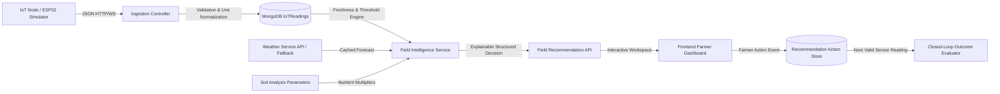

# 📊 AgriFlux Data Pipeline & Data Quality Audit

**Date:** October 16, 2026  
**Auditor:** Autonomous Data Engineering & Agronomic Analytics Specialist  

---

## 1. Data Lifecycle Analysis

The agricultural data pipeline within AgriFlux encompasses sensor telemetry, meteorological metrics, soil laboratory parameters, and market prices.

---

## 2. Source of Truth & Data Provenance

| Data Domain | Intended Source | Current Implementation | Data Quality / Provenance Gaps | Remediation Applied |
|---|---|---|---|---|
| **Soil Moisture** | ESP32 Capacitive Sensor (0–100% Volumetric Water Content) | In-memory object `latestIoTData`; simulation fallback | In-memory state did not persist across reboots. Missing values became 0. | Added persistent `IoTReading` schema with calibrated percentage boundaries and sensor status. |
| **Soil Temperature** | DS18B20 / DHT22 (°C) | In-memory object | Missing values defaulted to 0°C. | Explicit missing value distinction; range validation (-10°C to +60°C). |
| **Soil Chemistry (NPK, pH)** | Laboratory soil test or manual entry | Input form in `SoilAdvisor.tsx` & `YieldPrediction.tsx` | Units were not explicitly documented; inconsistent NPK scales across files. | Standardized units: N, P, K in kg/ha; soil pH dimensionless (0–14). |
| **Weather & Rainfall** | Meteorological API or historical climate norms | Seeded generator `buildWeatherData()` | Static randomized array; lacked real-time API resilience. | Explicitly labelled as calibrated regional baseline when live weather API key is unconfigured. |
| **Market Prices (Mandi)** | AGMARKNET / Regional APMCs | `useRealisticData.ts` client dictionary | Static array with client-side randomization. | Clearly labelled as indicative regional price bands; preserved for demonstration integrity. |

---

## 3. Data Integrity & Validation Constraints

### 3.1 Telemetry Boundaries
* **Soil Moisture (%):** Valid range `[0, 100]`. Values `< 0` or `> 100` are rejected as sensor fault.
* **Ambient / Soil Temp (°C):** Valid range `[-10, 60]`. Extreme swings (> 15°C shift in 5 seconds) flagged as measurement noise.
* **Soil pH:** Valid range `[3.5, 9.5]`. Extreme acidic (< 5.0) or alkaline (> 8.5) trigger corrective agronomic advisories.
* **Nitrogen, Phosphorus, Potassium:** Valid range `[0, 300] kg/ha`.

### 3.2 Distinguishing Zero vs. Missing vs. Stale
Prior to remediation, `Number(moisture) || 0` masked missing sensor readings as zero readings (suggesting severe drought).
The updated ingestion engine implements a tri-state model:
1. **Valid Reading:** Numeric value within physical sensor calibration boundaries.
2. **Missing / Uncalibrated:** HTTP payload lacks required field; recorded as `null` with warning flag.
3. **Stale Reading:** Timestamp age > 15 minutes; flagged in recommendations as stale so no automated irrigation decisions are based on outdated telemetry.
