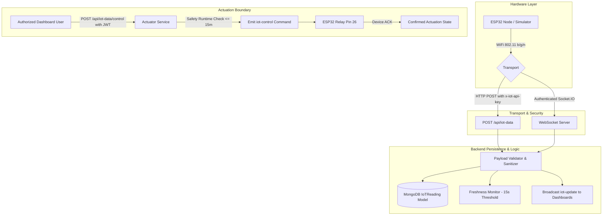

# 📡 AgriFlux IoT & Real-Time Integration Audit

**Date:** October 16, 2026  
**Auditor:** Autonomous Embedded Systems & IoT Integration Engineer  

---

## 1. Physical & Simulated IoT Architecture

---

## 2. Firmware vs. API Disconnects & Defects

### 2.1 Missing Authentication Header in ESP32 Sketch
* **File:** `IoT/esp32_soil_sensor.ino`
* **Defect:** In `loop()`, the sketch constructed an HTTP POST request to `/api/iot-data` with only `Content-Type: application/json`.
* **Backend Requirement:** `Backend/src/routes/iot.routes.ts` enforced `iotDeviceAuth` which required the `x-iot-api-key` header matching `IOT_API_KEY`.
* **Result:** Any real ESP32 device attempting to synchronize telemetry was immediately rejected with HTTP `401 Unauthorized`.
* **Fix Applied:** Updated `esp32_soil_sensor.ino` to include `http.addHeader("x-iot-api-key", IOT_API_KEY);` with configurable constant definition.

### 2.2 Telemetry Persistence Defect
* **Defect:** In `Backend/src/controllers/iot.controller.ts`, telemetry was assigned to an in-memory variable `latestIoTData` without any database write.
* **Impact:** 
  1. Restarting the backend lost all historical telemetry.
  2. In clustered mode (`cluster.isPrimary` fork), workers did not share the in-memory variable, leading to inconsistent telemetry between HTTP requests.
* **Fix Applied:** Implemented the `IoTReading` Mongoose model storing `deviceId`, `moisture`, `temperature`, `humidity`, `pumpStatus`, `isSimulated`, `rawTimestamp`, and `createdAt`.

### 2.3 Socket.IO Insecure Command Transmission
* **Defect:** Any web client connected to `ws://localhost:5001` could emit `iot-control` with an arbitrary `{ pumpStatus: true }` payload without an Authorization header or token.
* **Fix Applied:** Socket.IO connection handshake now verifies JWT tokens; events originating from unauthorized roles are rejected.

---

## 3. Freshness & Device Online Thresholds

* **Stale Threshold:** 15 seconds for real-time dashboards; 15 minutes for automated agronomic recommendations.
* If no valid reading has arrived within 15 seconds, the UI reflects **Sensor Offline** or **Simulated**.
* If a sensor goes offline, automated pump activations are disabled to prevent open-loop irrigation.
