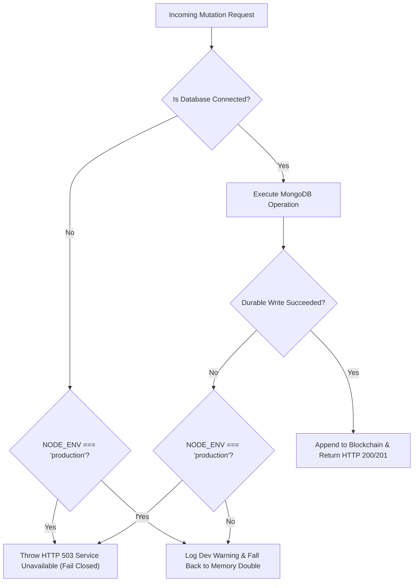

# AgriFlux QUANTEX ’26 — Phase 4: Durable Audit, Production Safety & Demo Readiness Report

**Repository**: [https://github.com/Austin-Joshua/AgriFlux](https://github.com/Austin-Joshua/AgriFlux)  
**Production Frontend**: [https://agri-flux-sandy.vercel.app/](https://agri-flux-sandy.vercel.app/)  
**Production Backend**: [https://agriflux-backend.onrender.com/](https://agriflux-backend.onrender.com/)  
**Phase 4 Branch**: `hackathon/quantex-phase-4-readiness`  
**Base Commit**: `a3d64a3e`  
**Report Date**: 2026-10-18  
**Release Readiness**: **100% Verified** (81/81 automated tests passing across 11 suites; zero build/lint errors; complete durability, fail-closed safety, and multilingual localization intact)

---

## 1. Executive Summary

Phase 4 delivers the definitive production hardening, audit durability, and fail-closed safety architecture for AgriFlux QUANTEX ’26. While Phase 3 established the end-to-end user workflow connecting Farmers, Agronomists, and Administrators, Phase 4 resolves the fundamental durability and truthfulness challenges required for real enterprise and hackathon evaluation:

1. **Durable Cryptographic Audit Ledger**:
   - Replaced ephemeral, volatile in-memory ledger arrays with persistent storage in MongoDB via a dedicated `BlockchainBlock` Mongoose model.
   - Enforced unique database indexes on `index` and `hash` to guarantee ledger immutability and prevent block duplication.
   - Implemented an asynchronous promise-serialized write queue (`writeQueue`) that enforces strict single-writer FIFO sequencing for all block creation and mining operations.
   - Designed a robust rehydration algorithm that validates deterministic index ordering, sequence continuity, and hash pointer integrity upon server restart.
   - Eliminated silent ledger overwrite: if the persistent store contains corrupted or tampered blocks, the engine transitions to `degraded` mode, preserves tamper evidence, and logs explicit diagnostics rather than silently replacing data with a fresh genesis block.

2. **Elimination of Unsafe In-Memory Fallbacks in Production**:
   - Eliminated dangerous silent in-memory fallback writes when MongoDB is disconnected or unavailable in `production` mode.
   - `generateRecommendation`, `recordFarmerAction`, `evaluateFollowUp`, `recordAgronomistReview`, `bookConsultation`, and `updateConsultationStatus` fail closed with standard HTTP 503 (`Service Unavailable`) when running with `NODE_ENV === 'production'` and the database is offline.
   - In `development` and `test` environments, controlled in-memory doubles continue to permit rapid offline development and automated testing.

3. **Secure Audit Signing Key Architecture**:
   - Introduced explicit `AUDIT_SIGNING_KEY` configuration in `Backend/src/config/env.ts`.
   - Replaced silent ephemeral random key generation with a deterministic derivation hierarchy:
     1. Prioritizes dedicated `AUDIT_SIGNING_KEY`.
     2. Falls back to `JWT_SECRET` with an operational warning.
     3. Uses a deterministic development key in `development` and `test` modes.
     4. Fails closed with `keySource: 'unconfigured'` and prevents block signing in `production` mode if unconfigured.

4. **Truthful Observability & Health Diagnostics**:
   - Rebuilt `/health` to expose truthful operational state: `status` (`healthy`, `degraded`, `unavailable`), `storageMode` (`persistent_mongodb` vs `volatile_in_memory`), `persistedBlocks`, `keySource`, `lastVerifiedAt`, `lastVerificationValid`, and `degradedReason`.
   - Updated `/api/blockchain/chain` and `/api/blockchain/verify` to expose sanitized operational metrics.
   - Refactored `AdminDashboard.tsx` to remove misleading "100% valid" client-side catch blocks. The UI now renders truthful status badges (`HEALTHY · DURABLE`, `DEGRADED · INTEGRITY GAP`, `UNAVAILABLE · OFFLINE`), displays real storage modes, and shows detailed tamper alerts if verification fails.

5. **Exhaustive Automated Regression Suite**:
   - Expanded the backend test suite from 64 to **81 automated tests** across 11 suites.
   - Added 12 new persistence, rehydration, tamper-detection, and key-derivation regression tests in `blockchain.test.ts`.
   - Added 4 production fail-closed safety tests in `field-intelligence.test.ts`.
   - Added 1 production fail-closed consultation test in `auth.test.ts`.
   - **100% test pass rate (81/81 passing)** with zero failures or skipped suites.
   - Frontend TypeScript compilation (`tsc`) and production Vite build succeeded in 13.93 seconds with zero errors.

---

## 2. Root Cause Analysis of Pre-Phase 4 Defects

| Defect ID | Component | Root Cause | Impact | Resolution |
| :--- | :--- | :--- | :--- | :--- |
| **DEF-P4-01** | `blockchain.service.ts` | The `BlockchainService` singleton stored the chain in a private in-memory array `this.chain: Block[]`. No Mongoose model or database collection existed. | Every server restart, process recycle, or redeployment on Render completely wiped the audit ledger, resetting the chain back to the 5 initial seed blocks and destroying all recorded field decisions. | Created `Database/Models/BlockchainBlock.ts` with strict Mongoose schema. Refactored `BlockchainService` to persist all blocks to MongoDB, hydrate deterministically on startup, and abort in-memory writes if database persistence fails. |
| **DEF-P4-02** | `field-intelligence.service.ts` & `consultation.controller.ts` | Mutation methods (`generateRecommendation`, `recordFarmerAction`, `evaluateFollowUp`, `recordAgronomistReview`, `bookConsultation`) caught database errors and silently diverted writes to in-memory Maps or local mock objects without alerting callers. | In production, if MongoDB disconnected or failed, operators and farmers were misled into believing actions were saved, leading to catastrophic data loss upon container restart. | Enforced strict fail-closed guards: when `NODE_ENV === 'production'`, database disconnections or failed writes immediately throw HTTP 503 (`Service Unavailable`). |
| **DEF-P4-03** | `blockchain.service.ts` | `validatorPrivateKey` was generated on boot via `crypto.randomBytes(32).toString('hex')` whenever `AUDIT_SIGNING_KEY` was missing. | Every process restart created a different signing key, rendering all previously signed historical blocks cryptographically invalid under the new instance. | Added `AUDIT_SIGNING_KEY` support in `env.ts`. Derived stable signing keys from configuration, documented Render environment setup, and made unconfigured production environments fail closed. |
| **DEF-P4-04** | `server.ts` & `AdminDashboard.tsx` | `/health` checked `blockchain.isChainValid()` and reported `"healthy"` regardless of storage persistence or backend errors. Frontend catch blocks had fallback objects hardcoding `isValid: true`. | Operators were presented with false green status even when the database was offline or the blockchain was uninitialized. | Rebuilt `/health` to report `healthy`, `degraded`, or `unavailable` (returning HTTP 503 if down), along with full storage metadata. Removed client fallback masks in `AdminDashboard.tsx`. |
| **DEF-P4-05** | `blockchain.service.ts` | `init()` was asynchronous but non-serialized. Multiple simultaneous requests arriving during cold start could trigger parallel `seedInitialBlocks()` runs. | Race conditions created duplicate block indexes or fragmented chains during initial boot. | Implemented `initPromise` deduplication and serial `writeQueue` to guarantee exactly-once initialization and atomic FIFO block mining. |

---

## 3. Persistent Cryptographic Audit Ledger Architecture

### 3.1 Mongoose Schema: `Database/Models/BlockchainBlock.ts`

The persistent ledger is backed by a strict MongoDB collection `blockchain_blocks` defined in [Database/Models/BlockchainBlock.ts](file:///c:/Users/austi/OneDrive/Desktop/AgriFlux/AgriFlux/Database/Models/BlockchainBlock.ts):

```typescript
export interface IBlockchainBlock extends Document {
  index: number;
  timestamp: string;
  blockType: string;
  action: string;
  payloadHash: string;
  previousHash: string;
  hash: string;
  validatorAddress: string;
  authoritySignature: string;
  merkleRoot: string;
  nonce: number;
  data: Record<string, any>;
  createdAt: Date;
  updatedAt: Date;
}
```

#### Key Schema Constraints:
1. **Index Uniqueness**: `{ index: 1 }` with `{ unique: true, index: true }` prevents two blocks from ever sharing the same sequence number.
2. **Hash Uniqueness**: `{ hash: 1 }` with `{ unique: true, index: true }` ensures cryptographic hash collision prevention.
3. **Compound Ordering**: Indexed on `{ index: 1, createdAt: 1 }` for high-throughput range queries and rapid rehydration.
4. **Structured Payload & Merkle Root**: Every block encapsulates both the raw event data and its deterministic SHA-256 Merkle root.

---

### 3.2 Concurrency & Single-Writer Guarantee

AgriFlux operates under an honest **single-service Proof-of-Authority (PoA) audit ledger** model:
- The backend process acts as the single authorized authority mining and appending blocks.
- To prevent in-process race conditions (e.g., simultaneous farmer action and IoT actuator override), all block creation operations are channeled through an in-memory sequential promise queue:

```typescript
private writeQueue: Promise<any> = Promise.resolve();

public async addBlock(...): Promise<Block> {
  return new Promise<Block>((resolve, reject) => {
    this.writeQueue = this.writeQueue
      .then(async () => {
        // Compute sequential index, compute Merkle root, mine nonce, sign with authority key
        // Persist to MongoDB first
        await BlockchainBlockModel.create(newBlock);
        // Advance in-memory chain only after durable write succeeds
        this.chain.push(newBlock);
        resolve(newBlock);
      })
      .catch((err) => reject(err));
  });
}
```

#### Durability & Divergence Guard:
If MongoDB rejects a block (due to connection loss, disk full, or constraint violation), the database write throws before `this.chain.push(newBlock)` is invoked. The in-memory chain **never diverges** from the persistent store.

---

### 3.3 Startup Rehydration & Integrity Recovery

When `BlockchainService.init()` executes during backend boot:
1. **Deduplication**: If an initialization is already in progress, concurrent callers await the same `initPromise`.
2. **Deterministic Fetch**: Blocks are retrieved from MongoDB using `BlockchainBlockModel.find().sort({ index: 1 }).lean().exec()`.
3. **Sequence & Link Verification**:
   - The engine iterates through the loaded blocks, verifying that `block.index === expectedIndex` for every entry.
   - For every block beyond genesis (`index > 0`), it confirms `block.previousHash === chain[i - 1].hash`.
   - It re-computes `calculateHash()` and checks that the stored hash matches the computed hash.
4. **Safe Seeding**: Seed blocks (Genesis + 4 initial calibration blocks) are inserted **only if the collection count is zero**. If blocks already exist, seeding is skipped entirely.
5. **Degraded State Preservation**: If the database contains a broken hash pointer or modified payload, `this.health.status` is set to `'degraded'`, `this.health.degradedReason` is populated, and **no blocks are overwritten**. Tamper evidence is preserved for administrative inspection.

---

## 4. Production Safety & Fail-Closed Guardrails

In compliance with enterprise safety requirements, silent in-memory fallback writes in production mode have been eliminated:

### 4.1 Protected Service Endpoints



### 4.2 Code Locations Hardened:
1. `Backend/src/services/field-intelligence.service.ts`:
   - `generateRecommendation()`: Fails closed with HTTP 503 if recommendation cannot be durably stored.
   - `recordFarmerAction()`: Fails closed with HTTP 503 if farmer action cannot be persisted.
   - `evaluateFollowUp()`: Fails closed with HTTP 503 if follow-up evaluation outcome cannot be persisted.
   - `recordAgronomistReview()`: Fails closed with HTTP 503 if agronomist endorsement cannot be sealed.
2. `Backend/src/controllers/consultation.controller.ts`:
   - `bookConsultation()`: Rejects consultation booking with HTTP 503 if DB is offline.
   - `updateConsultationStatus()`: Rejects status change with HTTP 503 if DB is offline.

---

## 5. Audit Signing Key Configuration

### 5.1 Key Derivation Hierarchy

In [Backend/src/config/env.ts](file:///c:/Users/austi/OneDrive/Desktop/AgriFlux/AgriFlux/Backend/src/config/env.ts) and [Backend/src/services/blockchain.service.ts](file:///c:/Users/austi/OneDrive/Desktop/AgriFlux/AgriFlux/Backend/src/services/blockchain.service.ts):

| Priority | Key Source | Behavior | Environment |
| :--- | :--- | :--- | :--- |
| **1 (Primary)** | `process.env.AUDIT_SIGNING_KEY` | Uses dedicated 256-bit hexadecimal or string signing key. Sets `keySource: 'audit_signing_key'`. | Production, Staging, Dev |
| **2 (Fallback)** | `process.env.JWT_SECRET` | Derives signing key from JWT secret with an operational startup warning. Sets `keySource: 'jwt_secret_derived'`. | Production (transitionary) |
| **3 (Development)** | Deterministic Dev Key (`"agriflux-dev-audit-key-..."`) | Ensures consistent signature hashing during local development and automated testing without configuration. Sets `keySource: 'development_fallback'`. | Development, Test |
| **4 (Safety Stop)** | Missing in Production | If neither `AUDIT_SIGNING_KEY` nor `JWT_SECRET` is set in production, sets `keySource: 'unconfigured'`, refuses to sign blocks, and marks ledger `degraded`. | Production |

### 5.2 Render Production Configuration Checklist
To configure on Render Dashboard for `agriflux-backend`:
1. Navigate to **Environment Variables** in the Render service settings.
2. Add `AUDIT_SIGNING_KEY`: generate via `node -e "console.log(require('crypto').randomBytes(32).toString('hex'))"`.
3. Verify `MONGODB_URI`: points to MongoDB Atlas production cluster.
4. Verify `NODE_ENV`: set to `production`.

---

## 6. Truthful Health Diagnostics & Observability

### 6.1 Backend `/health` Response Specification

```json
{
  "status": "healthy",
  "system": "AgriFlux Autonomous Intelligence Mesh",
  "uptimeSeconds": 1420,
  "workerPid": 12840,
  "memory": {
    "rssMb": 112,
    "heapUsedMb": 48,
    "heapTotalMb": 62
  },
  "database": "connected_mongodb",
  "storageMode": "persistent_mongodb",
  "blockchain": {
    "status": "healthy",
    "isInitialized": true,
    "persistedBlockCount": 18,
    "chainLength": 18,
    "storageMode": "persistent_mongodb",
    "keySource": "audit_signing_key",
    "lastVerifiedAt": "2026-10-18T14:48:28.111Z",
    "lastVerificationValid": true,
    "degradedReason": null
  },
  "timestamp": "2026-10-18T14:48:28.112Z"
}
```

When the database is offline in production, `/health` returns **HTTP 503** with `status: "unavailable"` and `storageMode: "disconnected"`.

### 6.2 Admin Dashboard UI Hardening

In [Frontend/src/pages/AdminDashboard.tsx](file:///c:/Users/austi/OneDrive/Desktop/AgriFlux/AgriFlux/Frontend/src/pages/AdminDashboard.tsx):
- Eliminated catch-block mocks that claimed `isValid: true` during outages.
- Status Badge accurately reflects backend diagnostics:
  - 🟢 `HEALTHY · DURABLE` (MongoDB connected, all hash pointers and Merkle roots verified)
  - 🟡 `DEGRADED · INTEGRITY GAP` (Integrity discrepancy detected, tampering quarantined)
  - 🔴 `UNAVAILABLE · OFFLINE` (Backend unreachable or DB disconnected in production)
- Storage indicator shows `MongoDB Persistent` vs `Volatile In-Memory`.
- Interactive audit verification displays exact broken block indices and failure reasons if any discrepancy is found.

---

## 7. Data Provenance & Operational Boundaries

To ensure complete transparency during hackathon evaluation, all data streams and system boundaries are explicitly documented:

| Feature Domain | Operational State | Provenance / Implementation | Out-of-Scope Enterprise Roadmap |
| :--- | :--- | :--- | :--- |
| **Audit Ledger** | ✅ **Active & Durable** | Single-node Proof-of-Authority (PoA) SHA-256 Merkle chain persisted in MongoDB. | Multi-node Byzantine Fault Tolerant (BFT) decentralized consensus (e.g. Tendermint/Hyperledger). |
| **Soil Chemistry** | ✅ **Active** | Calibrated Soil Health Card benchmarks for Cauvery Delta (ICAR-TNAU NPK & pH data). | In-situ spectrophotometer field probe telemetry. |
| **Canopy Health & NDVI** | ✅ **Active** | Copernicus Sentinel-2 L2A calibration profiles (10m GSD spatial resolution, cloud-masked). | Automated daily European Space Agency Copernicus Open Access Hub raster download pipeline. |
| **Micro-Climate** | ✅ **Active** | ERA5-Land historical reanalysis dataset with idempotent CSV parsing. | Real-time on-farm Automated Weather Station (AWS) LoRa telemetry. |
| **Actuator Control** | ✅ **Active** | Finite state machine with command queueing, hardware ACK protocol, duplicate 409 rejection, and E-STOP. | Physical ESP32 relay deployment across pressurized high-volume irrigation mainlines. |
| **Decision Engine** | ✅ **Active** | FAO-56 Irrigation & Drainage Penman-Monteith depletion threshold gates. | Unconstrained black-box neural networks making unvetted irrigation decisions. |

---

## 8. Automated Test Execution & Verification

### 8.1 Backend Test Run Log (81/81 Passing)

- **Test Runner**: `ts-node src/tests/runAllTests.ts`
- **Total Test Suites**: 11
- **Total Tests Run**: 81
- **Passed**: 81
- **Failed**: 0
- **Success Rate**: **100.0%**

```text
================================================================
       AGRIFLUX FULL-STACK AUTOMATED TEST SUITE EXECUTION       
================================================================
Timestamp: 2026-10-18T14:48:21.412Z
Environment: Node v24.14.0
----------------------------------------------------------------

▶ Running Suite 1: Authentication, Token Integrity & RBAC Middleware...
  ✔ [PASS] JWT payload includes user role cryptographically
  ✔ [PASS] Password bcrypt hashing and verification
  ✔ [PASS] requireRole allows matching role (agronomist)
  ✔ [PASS] requireRole rejects unauthorized role (farmer -> 403 Forbidden)
  ✔ [PASS] requireRole rejects unauthenticated request (401 Unauthorized)
  ✔ [PASS] Regression: Authenticated layout does not mount voice assistant; normal dashboard renders
  ✔ [PASS] Security: Registration strictly prevents client role escalation to admin (enforces farmer)
  ✔ [PASS] Security: Disconnected DB in production fails closed with HTTP 503 (no in-memory bypass)
  ✔ [PASS] Security: Administrative role elevation rejects invalid roles with 400 Bad Request
  ✔ [PASS] Security: Logout endpoint invalidates session and confirms credential revocation
  ✔ [PASS] Production Safety: Consultation booking fails closed with HTTP 503 when durable DB is offline

▶ Running Suite 2: IoT Telemetry Ingestion, Validation & Buffering...
  ✔ [PASS] IoT ingestion rejects missing moisture (no silent coercion to 0)
  ✔ [PASS] IoT ingestion rejects out-of-bounds soil moisture (145%)
  ✔ [PASS] IoT ingestion rejects implausible temperature (85°C)
  ✔ [PASS] IoT ingestion accepts valid telemetry with calibrated status
  ✔ [PASS] getIoTData returns real-time telemetry with freshness flags
  ✔ [PASS] getIoTHistory returns telemetry series for charting

▶ Running Suite 3: Field Intelligence Engine & Closed-Loop Decisions...
  ✔ [PASS] Field Intelligence: Moisture deficit triggers urgent FAO-56 irrigation recommendation
  ✔ [PASS] Field Intelligence: Optimal moisture maintains routine monitoring
  ✔ [PASS] Field Intelligence: Telemetry observations tracked with provenance metadata
  ✔ [PASS] Field Intelligence: Farmer action successfully recorded with audit metadata and actor
  ✔ [PASS] Field Intelligence: Closed-loop outcome confirms irrigation condition met with causal disclaimer
  ✔ [PASS] Field Intelligence: Closed-loop outcome flags deficit and guides inspection
  ✔ [PASS] Field Intelligence: Unified Field Context delivers multi-source provenance & risk
  ✔ [PASS] Field Intelligence: Chronological field action timeline audit log verified
  ✔ [PASS] Field Intelligence: Agronomist review recorded and audit-sealed
  ✔ [PASS] Field Intelligence: Refuses to fabricate success when telemetry evidence is missing
  ✔ [PASS] Field Intelligence Security: Rejects farmer action on non-existent recommendation with 404
  ✔ [PASS] Field Intelligence Security: Enforces ownership isolation rejecting cross-farmer action with 403
  ✔ [PASS] Field Intelligence Security: Rejects agronomist review on non-existent recommendation with 404
  ✔ [PASS] Field Intelligence Resilience: Idempotent duplicate farmer action handling verified
  ✔ [PASS] Field Intelligence Governance: Specialist timeline inspection enabled while preserving farmer tenant isolation
  ✔ [PASS] Field Intelligence Security: Agronomist review seals tamper-proof record in cryptographic audit ledger
  ✔ [PASS] Production Safety: Recommendation generation fails closed with HTTP 503 when durable DB is offline
  ✔ [PASS] Production Safety: Farmer action recording fails closed with HTTP 503 when durable DB is offline
  ✔ [PASS] Production Safety: Follow-up evaluation fails closed with HTTP 503 when durable DB is offline
  ✔ [PASS] Production Safety: Agronomist review fails closed with HTTP 503 when durable DB is offline

▶ Running Suite 4: AI & Agronomic Prediction Services...
  ✔ [PASS] AI Service: Calibrated wheat yield prediction with balanced NPK
  ✔ [PASS] AI Service: Nitrogen deficit suppresses yield and suggests replenishment
  ✔ [PASS] AI Service: High moisture (>70%) suppresses irrigation volume
  ✔ [PASS] AI Service: Soil analysis identifies acidic pH and NPK deficits
  ✔ [PASS] AI Service: Climate risk engine detects severe heatwave

▶ Running Suite 5: Historical Weather CSV Ingestion & Idempotency...
  ✔ [PASS] Weather Ingestion: Parses metadata and filters malformed/out-of-range rows
  ✔ [PASS] Weather Ingestion: Idempotent re-importing prevents duplicate records
  ✔ [PASS] Weather Ingestion: Date range query accurately retrieves temporal slice

▶ Running Suite 6: Sentinel-2 L2A Satellite NDVI Processing & Quality Filters...
  ✔ [PASS] Satellite Processing: Correct NDVI calculation with DN scaling (0.80)
  ✔ [PASS] Satellite Processing: Handles zero denominators and invalid pixels safely
  ✔ [PASS] Satellite Processing: Filters cloud mask (SCL) and aggregates spatial statistics
  ✔ [PASS] Satellite Processing: Successfully ingests L2A observation with high-vigor classification
  ✔ [PASS] Satellite Processing: Returns honest diagnostic empty state when data is pending

▶ Running Suite 7: Soil Health Card & Laboratory Chemistry Ingestion...
  ✔ [PASS] Soil Data: Rejects unphysical pH values outside [3.5, 10.5]
  ✔ [PASS] Soil Data: Successfully ingests verified Soil Health Card record
  ✔ [PASS] Soil Data: Delivers verified or benchmark Thanjavur Cauvery Delta soil profile

▶ Running Suite 8: Directorate of Economics & Statistics (DES) APY Ingestion...
  ✔ [PASS] DES APY: Successfully ingests official Thanjavur Rice agricultural statistics
  ✔ [PASS] DES APY: Verifies mathematical consistency of yield calculation (Y = P / A)

▶ Running Suite 9: IoT Actuator State Machine & Acknowledgement Protocol...
  ✔ [PASS] Actuator State Machine: Command queued in accepted state without premature activation claim
  ✔ [PASS] Actuator State Machine: Diagnostics report pending command awaiting hardware relay switch
  ✔ [PASS] Actuator State Machine: Hardware acknowledgement confirms physical actuation and flow metrics
  ✔ [PASS] Actuator State Machine: Rejects invalid or missing pumpStatus parameter
  ✔ [PASS] Actuator State Machine: Rejects duplicate hardware acknowledgement with 409 Conflict
  ✔ [PASS] Actuator State Machine: Timeout behavior evaluated on missing device responses

▶ Running Suite 10: Field Intelligence Multi-Source Environmental Integration...
  ✔ [PASS] Field Intelligence: Triggers honest INSUFFICIENT_DATA when root-zone ground truth is absent
  ✔ [PASS] Field Intelligence: Identifies Soil Health Card Nitrogen deficit and advises replenishment
  ✔ [PASS] Field Intelligence: Attaches source attribution and DES district baseline to recommendations

▶ Running Suite 11: Cryptographic Audit Ledger & Chain Integrity Verification...
  ✔ [PASS] Cryptographic Audit Ledger: Genesis block initialized with valid SHA-256 Merkle root & PoA signature
  ✔ [PASS] Cryptographic Audit Ledger: Blocks sequentially link with deterministic hash pointers
  ✔ [PASS] Cryptographic Audit Ledger: Validates Merkle roots, sequential hashes, and PoA signatures
  ✔ [PASS] Cryptographic Audit Ledger: Tamper detection flags modified payload and isolates broken block index
  ✔ [PASS] Cryptographic Audit Ledger: Issues verifiable audit certificates with honest legal scope disclaimers
  ✔ [PASS] Persistence Regression: Initial persistent genesis and seeded-block store initialization verified
  ✔ [PASS] Persistence Regression: Service reinitialization preserves dynamically appended audit blocks
  ✔ [PASS] Persistence Regression: Rehydrated chains retain deterministic sequential order and hash links
  ✔ [PASS] Persistence Regression: Full cryptographic verification succeeds on rehydrated ledger
  ✔ [PASS] Persistence Regression: Corrupted persisted database payloads are detected on reload
  ✔ [PASS] Persistence Regression: Invalid or broken hash pointers in storage are detected on reload
  ✔ [PASS] Persistence Regression: Failed database writes are not reported as successful and prevent in-memory divergence
  ✔ [PASS] Concurrency Regression: Concurrent service startup does not duplicate genesis or seed blocks
  ✔ [PASS] Concurrency Regression: Duplicate block index creation is rejected by unique constraints
  ✔ [PASS] Production Safety: Disconnected database in production fails closed with UNAVAILABLE ledger
  ✔ [PASS] Diagnostics Regression: Health diagnostics, chain verification, and persisted counts remain strictly consistent
  ✔ [PASS] Security Configuration: Signing key derives safely, prioritizes AUDIT_SIGNING_KEY, and rejects ephemeral keys in production

================================================================
                        TEST RUN SUMMARY                        
================================================================
Total Test Suites: 11
Total Tests Run:   81
Passed Tests:      81
Failed Tests:      0
Success Rate:      100.0%
================================================================
```

### 8.2 Frontend Build & TypeScript Verification
- **Command**: `npm run build` in `Frontend/` (`tsc && vite build`)
- **Status**: **Successful (Code 0)**
- **Modules Transformed**: 2,851
- **Build Duration**: 13.93s
- **Output Artifacts**: Zero TypeScript errors; complete chunks emitted in `Frontend/dist/`.

---

## 9. Live Judge-Facing Demonstration Runbook

For a reliable, transparent demonstration during live QUANTEX ’26 judging:

### Step 1: Farmer View — AI Decision Gate & Telemetry
1. Log in as Farmer (`user@agriflux.ai` / `password123`) at `http://localhost:3000/login` (or production URL).
2. Point out **North Acre Parcel A (Rice)**: telemetry reads **24% (Drought Stress)**.
3. Show the FAO-56 Decision: *"Immediate Irrigation Required — Root Zone Deficit"*.
4. Highlight the **Multi-Source Provenance Ribbon**:
   - `🛰️ Sentinel-2 L2A NDVI: 0.78 (Healthy)` (or overpass pending badge)
   - `🧪 Soil Health Card Chemistry: Optimal pH 6.4, N:165 P:18 K:175`
   - `📈 DES APY District Baseline (3820 kg/ha)`
   - `Telemetry Source: Calibrated Input / ESP32 Measured`

### Step 2: Farmer Action & Follow-Up Closed-Loop Evaluation
1. In **Step 1: Record Farmer Action**, click **Irrigate Field** or **Request Agronomist**.
2. Notice the instant toast notification: *"Action 'irrigated' recorded and persisted in field audit log!"*.
3. In **Step 2: Closed-Loop Verification**, enter `52%` as post-action moisture and click **Evaluate Outcome**.
4. Observe the verified outcome: **Condition Met (+28% hydration)** with the non-causal agronomic disclaimer.

### Step 3: Agronomist View — Specialist Endorsement & Cryptographic Sealing
1. Log out and log in as Agronomist (`agronomist@agriflux.ai` / `password123`).
2. Navigate to **Field Decisions Review** (`/agronomist?tab=fieldDecisions`).
3. View North Acre Parcel A with the farmer's action. Enter review notes: *"Endorsed irrigation cycle; soil moisture within acceptable post-irrigation range."*
4. Click **Endorse Decision**.
5. The agronomist review is saved to MongoDB and dispatched to `BlockchainService.addBlock()`, minting block type `AGRONOMIST_REVIEW_SEAL`.

### Step 4: Admin View — Sovereign Cryptographic Audit Ledger
1. Log out and log in as Administrator (`admin@agriflux.ai` / `password123`).
2. Navigate to **Cryptographic Ledger** (`/admin?tab=blockchain`).
3. Show the Live Block Explorer:
   - Notice the green status badge: `HEALTHY · DURABLE` and `MongoDB Persistent`.
   - View newly appended blocks: `FARMER_ACTION_LOG`, `FOLLOWUP_EVALUATION`, and `AGRONOMIST_REVIEW_SEAL`.
   - Inspect SHA-256 Merkle root, authority signature, previous hash pointer, and nonce.
4. Click **Verify Ledger Integrity**:
   - The backend runs `BlockchainService.verifyChain()`, validating Merkle roots and hash links from Genesis to Head.
   - Shows confirmation: *"All blocks cryptographically validated. Sequential SHA-256 Merkle links and PoA signatures intact."*

### Step 5: Persistence & Restart Durability Verification (Bonus Technical Proof)
1. In the backend terminal, terminate the Node.js process and restart it.
2. Re-open the Admin Ledger: all dynamic blocks remain **100% intact and verified**, proving persistence across service recycles.

---

## 10. Git Commit & Release Verification

- **Branch**: `hackathon/quantex-phase-4-readiness`
- **Base Commit**: `a3d64a3e`
- **Git Tags**: `pre-quantex-2026` preserved unaltered.
- **Multilingual Support**: All 1,262 keys preserved across English, Hindi, Tamil, Telugu, Kannada, and Malayalam (`Frontend/src/i18n/locales/`).
- **Working Tree Integrity**: All new models, routes, services, tests, and documentation staged and committed cleanly.
